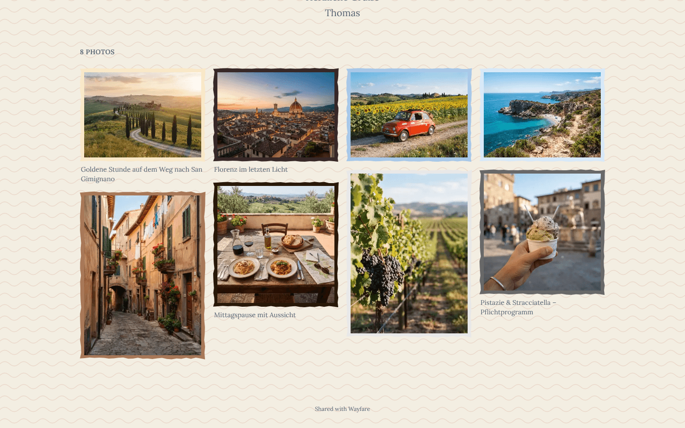
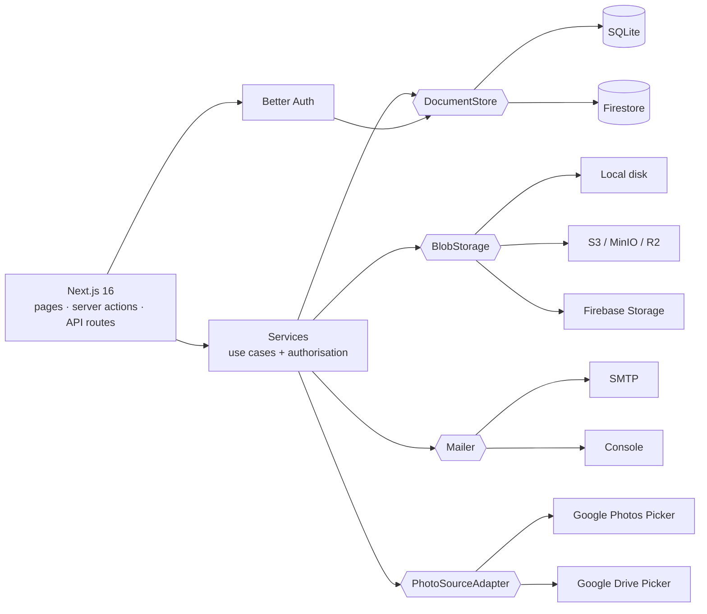

<div align="center">

# 📮 Wayfare

### Share photo albums like postcards — via QR code.

[](https://github.com/nullthrone/wayfare/actions/workflows/ci.yml)
[](https://nullthrone.github.io/wayfare/)
[](LICENSE)
[](https://ko-fi.com/tsprock)

[📚 Documentation](https://nullthrone.github.io/wayfare/) · [🚀 Quick start](#-quick-start) · [☁️ Firebase](#️-deploy-on-firebase) · [🤝 Contributing](#-contributing) · [🇩🇪 Deutsch](#-deutsch)



</div>

Wayfare is an open-source web app for sharing digital photo albums with friends and family — **like a postcard, but advanced**. Create an album, pick a theme for the occasion, print a QR code on a postcard or sticker, and let your guests scan it. No app to install, no tracking, your photos stay on **your** server or in **your** Firebase project.

Run it yourself with **Docker** (SQLite + local disk or S3) or serverless on **Firebase** (App Hosting + Firestore + Storage).

## ✨ Features

- 👥 **Roles** — admin, owner, viewer; onboarding by open sign-up, approval or invite links
- 🖼️ **Albums** — cover, greeting text, draft/published, per-album settings
- ⬆️ **Uploads & import** — drag & drop, plus **Google Photos** and **Google Drive** import (photos are copied, so albums outlive your Google link)
- 📱 **QR sharing** — QR code, link, WhatsApp/Web Share
  - 🖨️ **print templates**: A6 postcard (with bleed), sticker sheets, A4/A3 posters
  - 📲 **social formats**: story (1080×1920) and square (1080×1080)
- 🔐 **Access** — open link or password, expiry date, one-click **revoke & regenerate** of all QR codes
- 🎨 **13 occasion themes** (birthday, wedding, baby, Christmas, Easter, New Year, travel, thank you, anniversary, graduation, Valentine, memorial, neutral) and a **theme builder** with export/import
- 💬 **Reactions & comments** with theme-specific emoji, moderation (off / publish / approve first), reports and viewer blocking
- 🔑 **Social login** — Google, Apple, Facebook, Discord, magic link, passkeys (and optional e-mail/password)
- 📥 **Guest uploads** — guests contribute photos, you approve them
- 🛡️ **Download protection** — no originals, signed short-lived URLs, optional **watermark** (honest docs: screenshots can't be prevented)
- 🔔 **Notifications** — instant or daily digest e-mails
- 📊 **Privacy-friendly stats** — anonymous views, no IPs, no cookies, no third parties
- 🌍 **German & English**, self-hosted fonts, EXIF/GPS stripped from delivered images

## 🚀 Quick start

### Docker Compose (self-hosted)

```bash
git clone https://github.com/nullthrone/wayfare.git
cd wayfare
cp .env.example .env
# edit .env: WAYFARE_SECRET (32+ random chars), WAYFARE_BASE_URL, WAYFARE_ADMIN_EMAILS
docker compose up -d --build
```

Open <http://localhost:3000>. Whoever signs up with an address from `WAYFARE_ADMIN_EMAILS` (or the very first user) becomes admin. Optional profiles: `--profile cron` (daily digest), `--profile minio` (S3 for testing). Put a reverse proxy with HTTPS in front for production — see the [self-hosting guide](https://nullthrone.github.io/wayfare/en/operator/self-hosting).

### Local development

```bash
npm ci
cp .env.example .env     # set WAYFARE_SECRET
npm run dev              # http://localhost:3000
npm run lint && npm run typecheck && npm test
```

Needs Node.js 22. Without `SMTP_URL`, magic links are printed to the console.

## ☁️ Deploy on Firebase

Open [Google Cloud Shell](https://shell.cloud.google.com) and run the interactive, re-runnable bootstrap — it sets up the project, Firestore, a private media bucket, the `WAYFARE_ENV` config secret and an App Hosting backend, deploys Wayfare and measures the proxy setup:

```bash
bash <(curl -fsSL https://raw.githubusercontent.com/nullthrone/wayfare/main/scripts/firebase-bootstrap.sh)
```

Needs the **Blaze** plan (small instances usually stay near the free quotas). Optional: a daily-digest Cloud Scheduler job and a GitHub Actions workflow that deploys on every GitHub Release (always on in this repo, opt-in in forks via `FIREBASE_DEPLOY_ENABLED`).

Full walkthrough incl. manual setup: [Firebase guide](https://nullthrone.github.io/wayfare/en/operator/firebase).

## 🧱 Architecture

One codebase, two runtimes — **ports & adapters**. Services contain the business logic and authorisation; the composition root (`src/server/container.ts`) picks the adapters from `WAYFARE_RUNTIME`.



Details: [ARCHITECTURE.md](ARCHITECTURE.md) and the [ADRs](docs/adr).

## 📚 Documentation

**<https://nullthrone.github.io/wayfare/>** — user guide and operator guide in English and German: albums, sharing & printing, themes, moderation, Docker, Firebase, login providers, Google import, security & GDPR notes, full configuration reference.

## 🤝 Contributing

Contributions are very welcome — start with [CONTRIBUTING.md](CONTRIBUTING.md) (setup, conventions, adding themes/sources/login providers, Conventional Commits). Look for [`good first issue`](https://github.com/nullthrone/wayfare/labels/good%20first%20issue). Please follow the [Code of Conduct](CODE_OF_CONDUCT.md); report vulnerabilities privately as described in [SECURITY.md](SECURITY.md).

## 💖 Sponsoring

Wayfare is free and made in spare time. If it helps you share your memories, you can buy me a coffee:

[](https://ko-fi.com/tsprock)

## 📄 License

[MIT](LICENSE) © Wayfare contributors

The sample photos used for demo data and documentation screenshots (`e2e/fixtures/photos/`) are
**synthetic, AI-generated images** without identifiable people, dedicated to the public domain under
[CC0 1.0](https://creativecommons.org/publicdomain/zero/1.0/) — see
[`e2e/fixtures/photos/LICENSES.md`](e2e/fixtures/photos/LICENSES.md). They are not covered by the MIT license.

---

## 🇩🇪 Deutsch

**Wayfare** teilt Fotoalben wie eine Postkarte – nur moderner: Album erstellen, Theme passend zum Anlass wählen, QR-Code auf Postkarte oder Sticker drucken, fertig. Selbst gehostet (Docker) oder auf Firebase, ohne Tracking.

📚 **Dokumentation (Deutsch):** <https://nullthrone.github.io/wayfare/de/guide/> · Betreiberhandbuch: <https://nullthrone.github.io/wayfare/de/operator/>

Schnellstart: `cp .env.example .env`, `WAYFARE_SECRET` setzen, `docker compose up -d --build`, <http://localhost:3000> öffnen.
