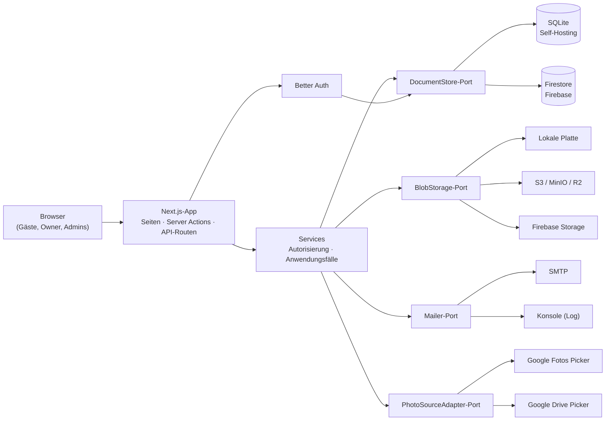

# Betreiberhandbuch

Dieser Teil richtet sich an die Person, die eine Wayfare-Instanz **betreibt**. Du kannst sie selbst mit Docker hosten oder auf Google Firebase. Beide Varianten nutzen dieselbe Codebasis.

## Architektur

Wayfare ist eine Next.js-16-Anwendung nach dem Muster *Ports & Adapters*: Die Geschäftslogik spricht mit kleinen Schnittstellen, und der Container wählt beim Start anhand von `WAYFARE_RUNTIME` die Implementierung.

| Port | Self-Hosting (`WAYFARE_RUNTIME=selfhost`) | Firebase (`WAYFARE_RUNTIME=firebase`) |
|---|---|---|
| `DocumentStore` | SQLite (`better-sqlite3`, JSON-Dokumente) in `DATA_DIR` | Firestore (`firebase-admin`) |
| `BlobStorage` | Lokales Dateisystem oder S3-kompatibel | Firebase Storage (oder S3) |
| `Mailer` | SMTP oder Konsole | SMTP oder Konsole |
| `PhotoSourceAdapter` | Google Fotos Picker, Google Drive Picker | gleich |
| Auth | Better Auth auf dem `DocumentStore` | gleich |

Warum ein generischer `DocumentStore`? Siehe [ADR 0001](https://github.com/nullthrone/wayfare/blob/main/docs/adr/0001-document-store-port.md).

## Seiten in diesem Handbuch

| Seite | Thema |
|---|---|
| [Self-Hosting](./self-hosting) | Docker Compose, HTTPS-Reverse-Proxy, Backups, Updates |
| [Firebase](./firebase) | App Hosting + Firestore + Storage: Einrichtung per Cloud-Shell-Befehl, Release-Workflow, manuelle Schritte |
| [Konfiguration](./configuration) | Alle Umgebungsvariablen |
| [Authentifizierung](./authentication) | Google, Apple, Facebook, Discord, Magic Link, Passkeys, Admins |
| [Foto-Quellen](./photo-sources) | Einrichtung des Google-Fotos-/Drive-Imports |
| [Speicher](./storage) | Lokal, S3, Firebase Storage |
| [E-Mail](./mail) | SMTP und der tägliche Digest |
| [Sicherheit & Datenschutz](./security) | Sicherheitsmodell und DSGVO-Hinweise |
| [Fehlersuche](./troubleshooting) | Häufige Probleme |

## Admin-Bereich

Admins verwalten die Instanz im Browser unter **/admin**: Onboarding-Modus, Instanzname, Upload-Limits, Rechtstexte und Nutzer.

## Health-Check

`GET /api/health` liefert `{"status":"ok"}`, wenn die Datenbank erreichbar ist (sonst HTTP 503). Das Docker-Image nutzt das für seinen `HEALTHCHECK`; richte auch deinen Uptime-Monitor darauf aus.
