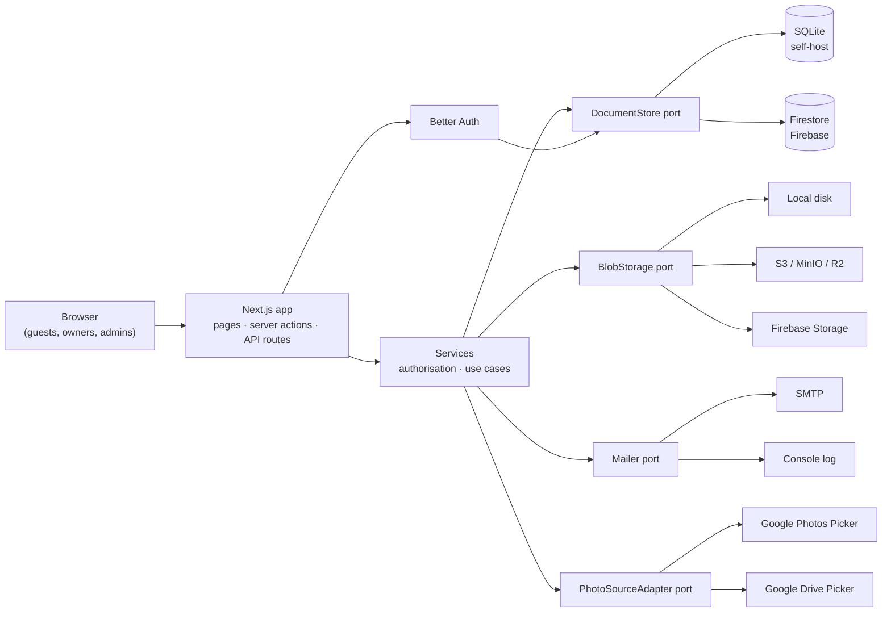

# Operator guide

This part is for the person who **runs** a Wayfare instance. You can host it yourself with Docker, or on Google Firebase. The same codebase serves both.

## Architecture

Wayfare is a Next.js 16 application built with *ports & adapters*: the business logic talks to small interfaces, and the container picks the implementation at start-up based on `WAYFARE_RUNTIME`.

| Port | Self-hosted (`WAYFARE_RUNTIME=selfhost`) | Firebase (`WAYFARE_RUNTIME=firebase`) |
|---|---|---|
| `DocumentStore` | SQLite (`better-sqlite3`, JSON documents) in `DATA_DIR` | Firestore (`firebase-admin`) |
| `BlobStorage` | Local filesystem or S3-compatible | Firebase Storage (or S3) |
| `Mailer` | SMTP or console | SMTP or console |
| `PhotoSourceAdapter` | Google Photos Picker, Google Drive Picker | same |
| Auth | Better Auth on top of the `DocumentStore` | same |

Why one generic `DocumentStore`? See [ADR 0001](https://github.com/nullthrone/wayfare/blob/main/docs/adr/0001-document-store-port.md).

## Pages in this guide

| Page | Topic |
|---|---|
| [Self-hosting](./self-hosting) | Docker Compose, HTTPS reverse proxy, backups, upgrades |
| [Firebase](./firebase) | App Hosting + Firestore + Storage, step by step |
| [Configuration](./configuration) | Every environment variable |
| [Authentication](./authentication) | Google, Apple, Facebook, Discord, magic link, passkeys, admins |
| [Photo sources](./photo-sources) | Google Photos / Drive import setup |
| [Storage](./storage) | Local, S3, Firebase Storage |
| [Mail](./mail) | SMTP and the daily digest |
| [Security & privacy](./security) | Security model and GDPR notes |
| [Troubleshooting](./troubleshooting) | Common problems |

## Admin area

Admins manage the instance in the browser under **/admin**: onboarding mode, instance name, upload limits, legal pages and users.

## Health check

`GET /api/health` returns `{"status":"ok"}` when the database is reachable (HTTP 503 otherwise). The Docker image uses it for its `HEALTHCHECK`; point your uptime monitor at it too.
